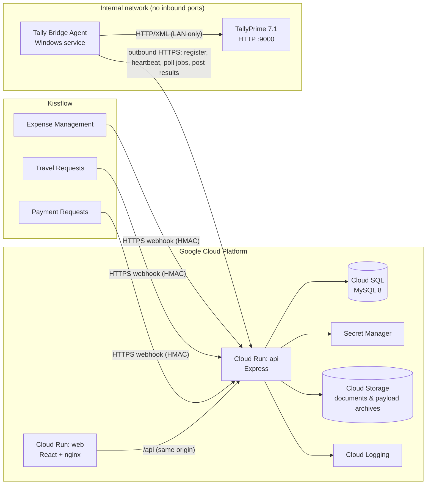
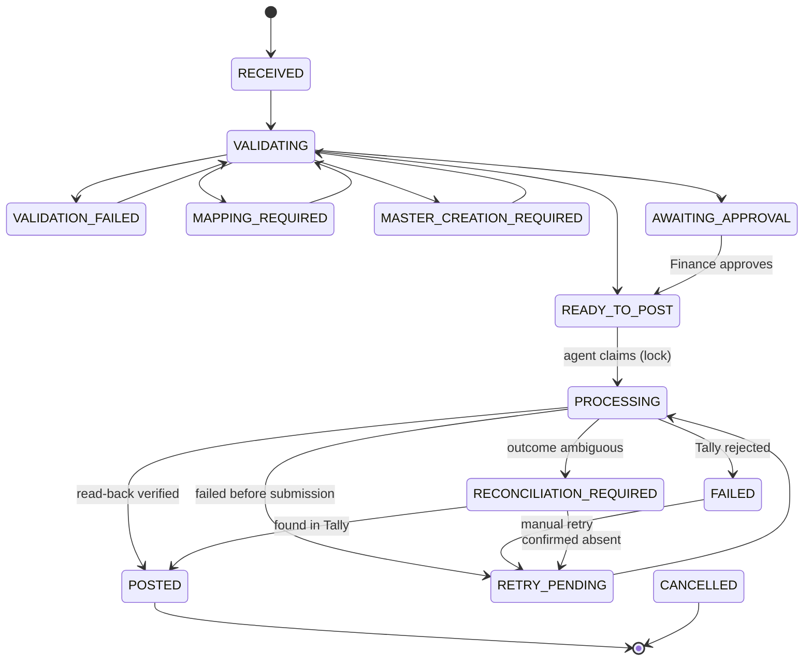

# Tally Monitor – Architecture & Implementation Plan

## 1. Purpose

Tally Monitor is the controlled intermediate layer between many Kissflow applications and TallyPrime across multiple group companies. It **receives, persists, validates, routes for approval, posts and verifies** accounting transactions. Nothing reaches Tally without passing validation, the configured Finance approval policy and an idempotency check, and nothing is reported as posted until Tally confirms it on read-back.

This plan reuses the hard-won rules from the earlier `refex-tally-integration` pilot (one-use authorization, `SUBMISSION_UNKNOWN` before import, exact read-back, no blind retry) and generalizes them into a multi-application, multi-company platform.

## 2. System context



Cloud Run can **never** reach `192.168.x.x` directly. The Bridge Agent is the network boundary: it only makes outbound HTTPS calls, so port 9000 is never exposed.

## 3. Components

| Component | Tech | Responsibility |
|---|---|---|
| `frontend/` | React 19, Vite, MUI 9, TanStack Query, Zustand, Framer Motion, Recharts | Operator UI, dashboards, configuration screens |
| `backend/` | Node 20+, Express 5, Sequelize 6, MySQL 8, Zod, Winston | Auth, RBAC, ingestion, validation, queue, agent API, reporting |
| `bridge-agent/` (Phase 6) | Node 20+, Windows service | Polls jobs, talks to TallyPrime, verifies vouchers, reports results |

### Backend module layout

```
backend/
  database/            sequelize-cli migrations + seeders (CommonJS)
  src/
    config/            env validation (zod), logger (redacting, Cloud Logging severity)
    db/                Sequelize connection (UTC, utf8mb4)
    domain/            pure rules: job state machine, RBAC catalog
    models/            Sequelize models + associations
    middleware/        auth, CSRF, rate limits, validation, errors, request context
    services/          auth, audit, dashboard, health, access scope, mail
    routes/            versioned REST routers (/api/v1)
  test/                vitest unit tests
```

Later phases add `services/ingestion`, `services/accounting`, `services/queue`, `adapters/kissflow/*`, and the agent API, following the same layering (routes → services → models; domain rules stay pure and unit-tested).

## 4. Data model

28 tables across six migrations (the 24 required tables plus `role_permissions`, `user_companies`, `user_sessions` and `password_reset_tokens`). All exposed resources use a `uuid` (CHAR(36)); high-volume tables use `BIGINT UNSIGNED` keys; money is `DECIMAL(18,2)`; all timestamps are `DATETIME(3)` stored in UTC.

| Area | Tables |
|---|---|
| Identity & access | `users`, `roles`, `permissions`, `role_permissions`, `user_roles`, `user_companies`, `user_sessions`, `password_reset_tokens` |
| Infrastructure | `integration_agents`, `tally_servers`, `companies` |
| Sources | `applications`, `application_companies` (many-to-many with `source_company_key`), `application_credentials` (AES-256-GCM), `source_field_mappings` |
| Accounting | `ledger_masters`, `ledger_mappings`, `voucher_configurations`, `voucher_mappings` |
| Transactions & queue | `expense_transactions`, `expense_items`, `processing_jobs`, `job_attempts`, `tally_responses`, `master_creation_requests`, `posted_vouchers` |
| Governance | `audit_logs` (append-only, enforced by triggers), `system_settings` |

Key integrity rules enforced by the database:

- `expense_transactions (application_id, source_transaction_id)` unique, plus a global `idempotency_key` — duplicate webhooks cannot create a second expense.
- `processing_jobs.idempotency_key` unique and `posted_vouchers.job_id` unique — one job, at most one voucher.
- `posted_vouchers (company_id, reference)` unique — the same reference cannot be posted twice into a company.
- `companies (tally_server_id, tally_company_name)` unique — a Tally company maps to exactly one Tally Monitor company.
- Ledger and voucher mappings use stored generated `scope_key` columns so company-wide defaults (NULL application) are unique too.
- Every expense, job, mapping and voucher carries a `company_id`; every company-owned query applies the user's company scope (`services/access.ts`).

## 5. Security model

- **Passwords**: bcrypt (cost 12), 12+ chars with mixed case, digit and symbol.
- **Sessions**: 15-minute JWT access token kept only in memory; opaque refresh token in an HTTP-only, `SameSite=Strict`, path-scoped cookie; only its SHA-256 hash is stored.
- **Rotation**: every refresh revokes the old token and issues a new one in the same family; replay of a rotated token revokes the entire family (theft detection). A 20-second grace window handles legitimate multi-tab races.
- **CSRF**: double-submit token (`tm_csrf` cookie + `X-CSRF-Token` header) on cookie-authenticated endpoints. Bearer-authenticated endpoints are not CSRF-exposed.
- **Lockout**: configurable failed-attempt threshold and lockout window; per IP+email login rate limiting; generic error messages and constant-time handling of unknown emails.
- **Authorization**: permission-based RBAC (27 permissions, 6 configurable roles) plus company-level scoping.
- **Secrets**: Kissflow credentials encrypted with AES-256-GCM using a key from Secret Manager; agent secrets stored as SHA-256 hashes; logs and audit metadata pass through a redactor.
- **Transport**: Helmet (strict CSP for the API), explicit CORS allow-list, HTTPS on Cloud Run, Cloud SQL via unix socket.

## 6. Processing pipeline (Phases 3–6)



The transition table lives in `backend/src/domain/jobStatus.ts` and is unit-tested. Every transition is executed as a conditional `UPDATE ... WHERE status = :from` inside a transaction, with a `job_attempts` row and an audit record.

1. **Ingestion** – `POST /api/v1/webhooks/:applicationCode` verifies the HMAC signature, stores the raw payload and hash, derives the idempotency key, creates the expense and its job in one transaction, and returns `202` immediately. It never calls Tally.
2. **Normalization** – per-application `source_field_mappings` (JSON paths + transforms) produce the common expense shape; the source payload's company key is resolved through `application_companies`.
3. **Validation** – company active and linked, Tally company configured, ledgers mapped and present in `ledger_masters`, voucher configuration resolved, debit = credit.
4. **Missing masters** – job → `MASTER_CREATION_REQUIRED`; a `master_creation_requests` row proposes name/group; Finance approves; the agent creates the master in the exact company and reads it back before revalidation.
5. **Approval** – `voucher_configurations.approval_policy` (ALWAYS, ABOVE_THRESHOLD, NEVER) decides `AWAITING_APPROVAL` vs `READY_TO_POST`.
6. **Posting** – the agent claims jobs (`SELECT ... FOR UPDATE SKIP LOCKED`, one in-flight job per company by default, lease + heartbeat), records `submission_started_at` *before* sending XML, posts with `SVCURRENTCOMPANY` set explicitly, then reads the voucher back by reference.
7. **Verification** – `POSTED` only when the read-back matches company, date, voucher type, every ledger and amount; MasterID, AlterID and voucher number are stored in `posted_vouchers`.
8. **Failure handling** – transient errors before submission get exponential backoff up to `max_attempts`, then dead-letter. If a submission may have reached Tally, the job becomes `RECONCILIATION_REQUIRED` and is never retried until a reference lookup proves the voucher is absent.

## 7. Tally Bridge Agent (Phase 6)

- Unique agent identity (`agent_key` + secret shown once, stored hashed, revocable).
- Loop: heartbeat (every 30 s) → claim job → execute → report result. Exponential backoff on network loss; daily rotating JSON logs in the agent's `logs\` folder (configurable `LOG_DIR`).
- Adapter interface: `listCompanies`, `listLedgers`, `createLedger`, `createVoucher`, `readVoucher`, `health`. Initial implementation is HTTP/XML; native JSON in TallyPrime 7.1 will be evaluated against the same contract tests and adopted only if behaviour is identical.
- A per-server mutex serializes company-context-sensitive operations.
- Installed as a Windows service (NSSM or `node-windows`), running under a dedicated low-privilege account.

## 8. GCP deployment (Phase 8)

| Resource | Configuration |
|---|---|
| Artifact Registry | `tally-monitor` Docker repo |
| Cloud Run `tally-monitor-api` | min instances 1, Cloud SQL connector, secrets as env vars, `TRUST_PROXY=1` |
| Cloud Run `tally-monitor-web` | nginx serving the SPA and proxying `/api` to the API service (same-origin cookies) |
| Cloud SQL | MySQL 8, private IP, automated backups + PITR, flag `log_bin_trust_function_creators=on` for the audit triggers |
| Secret Manager | `JWT_ACCESS_SECRET`, `ENCRYPTION_KEY`, `DB_PASSWORD`, SMTP credentials |
| Cloud Storage | supporting documents and archived Tally request/response payloads |
| Cloud Build | lint → test → build images → migrate (job) → deploy |
| IAM | separate service accounts for API (Cloud SQL Client, Secret Accessor, Storage Object Admin on one bucket) and Cloud Build |

Migrations run as a Cloud Run job before traffic shifts; the API never migrates on startup.

## 9. Delivery phases

| Phase | Scope | Status |
|---|---|---|
| 1 – Foundation | Monorepo, Express API, full MySQL schema + models, RBAC seed, JWT/refresh rotation, lockout, password reset, login UI, app shell, sidebar, theme system, live dashboard + health | **Delivered** |
| 2 – Configuration | Companies, Applications (wizard, credentials, many-to-many links), Tally connections & agent registry, Settings, Users & roles | **Delivered** |
| 3 – Expense Integration | Webhook endpoint with HMAC/bearer auth, source adapters, field mapping UI with preview, normalization, API sync, manual import, intake logs, expense list/detail with timeline | **Delivered** |
| 4 – Accounting Engine | Voucher engine, ledger list/import, category mappings, unmapped/missing detection, Finance-approved master requests, voucher configurations & routing, voucher preview, accounting validation through the state machine | **Delivered** |
| 5 – Queue Engine | Worker (auto-validation, stale-lock recovery, DB lease), Finance approvals bound to voucher hash, claim/lock/heartbeat, per-company serialization, backoff, dead-letter, reconciliation, server-side agent contract with read-back verification, queue/job/audit UI | **Delivered** |
| 6 – Tally Bridge | Standalone Windows agent (`bridge-agent/`), Tally XML adapter, company discovery, ledger sync, approved ledger creation, voucher import + read-back, durable result outbox, diagnostics CLI, NSSM service scripts | **Delivered** (live ledger sync proven on TallyPrime 7.1; posting pilot is an ops step) |
| 7 – Reporting | Ten reports, filters, charts, Excel/CSV/PDF export, company Reports tab | **Delivered** |
| 8 – Deployment | Dockerfiles, Cloud Build, Cloud Run, Cloud SQL, Secret Manager, Windows agent installer | Next |
